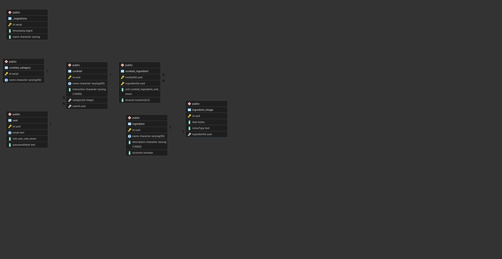
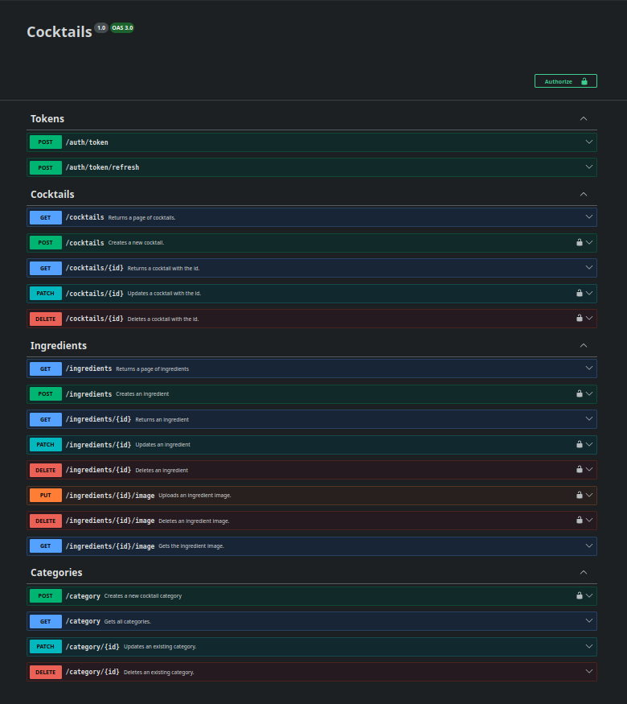

## Description

## Project setup

```bash
$ npm install
$ cp .env.example .env
```

Then fill out .env

You can run the database container with:

```bash
$ docker compose up -d
```

Apply migrations with

```bash
$ npm run migration:run
```

## Compile and run the project

```bash
# development
$ npm run start

# watch mode
$ npm run start:dev

# production mode
$ npm run start:prod
```

## Users

2 default users are created on startup if the users table is empty.

| Email             | Password | Role  |
| ----------------- | -------- | ----- |
| user@example.com  | test     | USER  |
| admin@example.com | test     | ADMIN |

## Run tests

```bash
# unit tests
$ npm run test

# e2e tests
$ npm run test:e2e

# test coverage
$ npm run test:cov
```

## Database schema:



## Swagger

Swagger is avalible at `http://localhost:3000/api`

